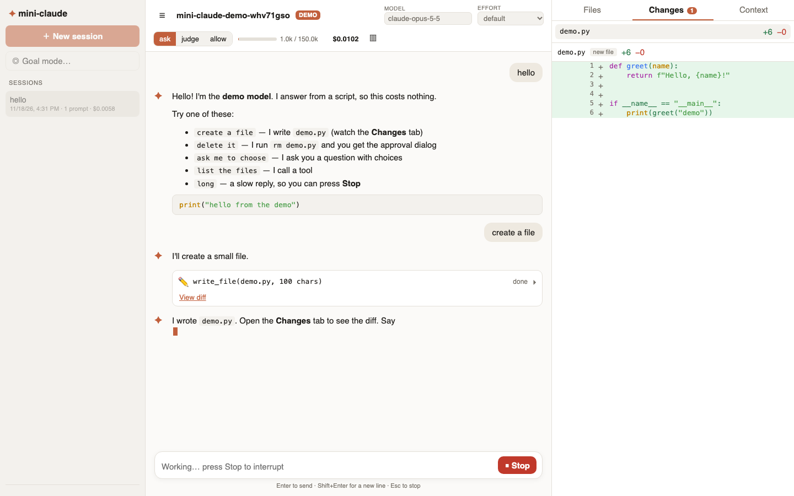
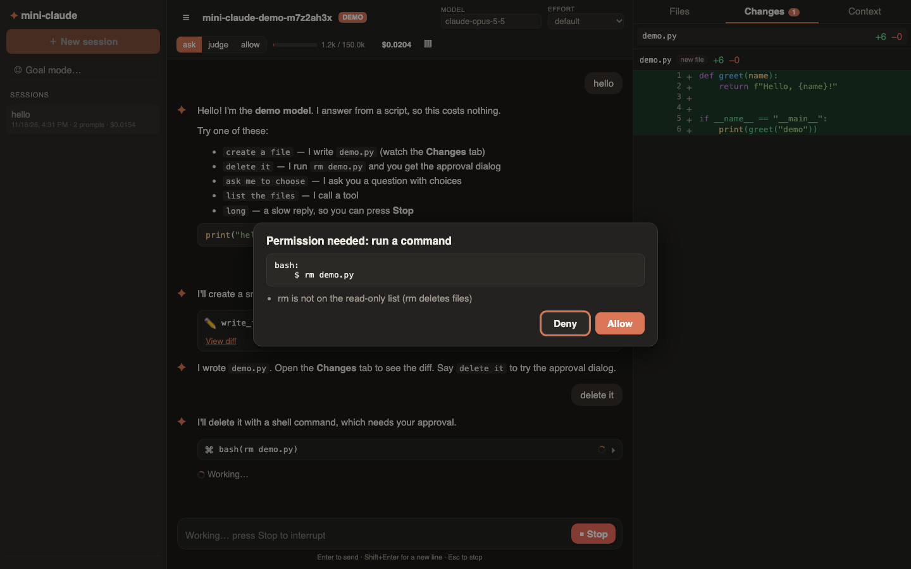

# mini-claude

[](https://github.com/callumritchie/mini-claude/actions/workflows/ci.yml)

A small coding agent in Python, in the spirit of Claude Code and Cursor. Use it in the terminal or in a local web UI; it works with
Anthropic's API (Claude) and DeepSeek's Anthropic-compatible endpoint.

<p align="center">
  
  
</p>

## What it does

- **Tools:** read, write and edit files (edits replace exact text, in a file it has read), run commands, search the project, web search
  (the provider's), ask you a question, and run read-only subagents.
- **Safety first:** harmless things run; anything risky is shown *exactly* and asked yes/no, with hidden characters made visible. Headless it
  denies and tells you how to pre-approve (`--allow "pytest"`). An optional AI judge can take the easy questions (it never sees file
  contents or tool output, and secrets always come to you). Searching is free inside the project and never shows secret files.
- **Long work:** conversations are summarised near a limit you set; every message is saved to an append-only log so a crash loses nothing
  (`-c` continues); `--goal` works unattended until the job is done with evidence, your check passes and a fresh reviewer agrees.
- **Money:** every call is priced and shown; `--max-turns` and `--max-cost` stop a run; a model missing from the price list is reported as
  unpriced, never as $0.
- **Extending:** skills (`.claude/skills/`, `skills/`, `.agents/skills/`) and MCP servers (`.mcp.json`) in Claude Code's formats; `AGENTS.md` is
  loaded as instructions.

## Quick start

```sh
pip install -e .                       # or: pip install -r requirements.txt
export ANTHROPIC_API_KEY="..."         # put this in ~/.zshrc, never in the project (or DEEPSEEK_API_KEY)
python3 agent.py                       # terminal chat
python3 agent.py -p "say hi"           # one task, answer on stdout
```

Run it from the folder you want it to work in. Keys come from the environment only and are never printed or saved.

### Web UI

```sh
pip install -e ".[ui]"
cd ui && npm install && npm run build && cd ..
python3 agent.py --ui                  # opens http://127.0.0.1:8765/?token=... in your browser
python3 agent.py --ui --demo           # try it with a scripted fake model: no key, no cost, throwaway folder
```

Chat with streaming markdown, tool calls as cards, the approval dialog, `ask_user` questions with choices, a session list, model / effort /
permission switches, a live cost and context meter, a file tree and viewer, and a diff of every file the agent writes. Type `/` for commands.

The web server can run commands as you, so it listens on `127.0.0.1` only, needs a random per-launch token, checks the `Host` and `Origin`
headers, never serves secret-looking files, and renders model text without raw HTML or remote images. Details in `DESIGN.md` ("Web UI").

## Terminal commands

`/new` `/sessions` `/resume [n]` `/model` `/permissions` `/effort` `/context` `/compact` `/limit` `/goal` `/help` `/exit`. Ctrl-C stops the
current turn, not the program.

```sh
python3 agent.py --json -p "say hi"                 # one JSON line: result, tokens, cost
python3 agent.py --effort low --model claude-sonnet-5-5
python3 agent.py --permissions judge
python3 agent.py --goal "add add() with a test" --verify "python3 -m unittest -q" --allow "python3 -m unittest"
```

Headless exit codes: `0` done, `1` error (no key, bad model, API error), `3` did not finish (turn or spending limit, goal not met), `130` Ctrl-C.

## Development

```sh
pip install -e ".[dev]"
python tests/test_loop.py && python tests/test_server.py     # no API key needed
cd ui && npm test && npm run e2e                              # unit tests, then a real browser against the demo model
```

See `CONTRIBUTING.md`. `DESIGN.md` documents how everything works and every decision.

## Status

Tested live on Claude. **DeepSeek is untested** (no key to test with). MCP supports stdio servers and tools only. The web UI is single-user,
one project per server, macOS/Linux first.

## Licence

MIT, see `LICENSE`.
